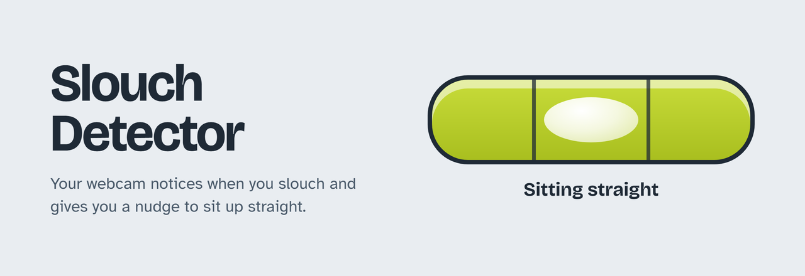
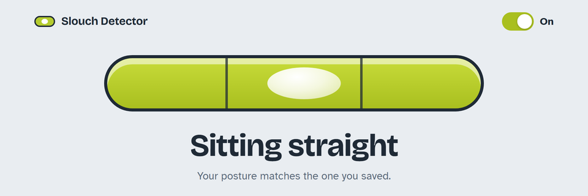
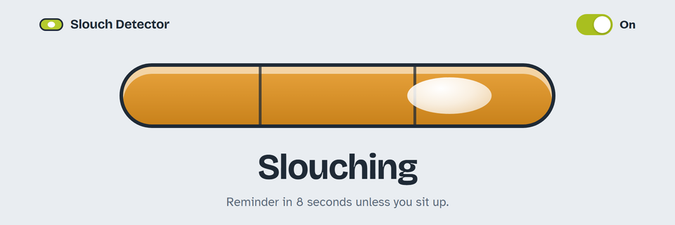
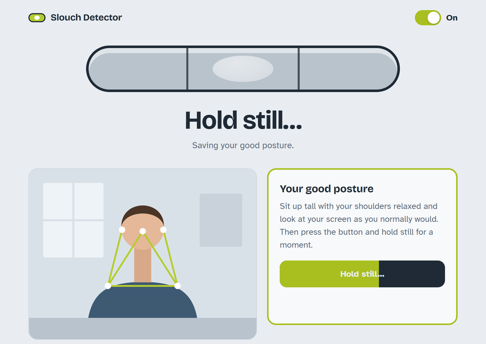
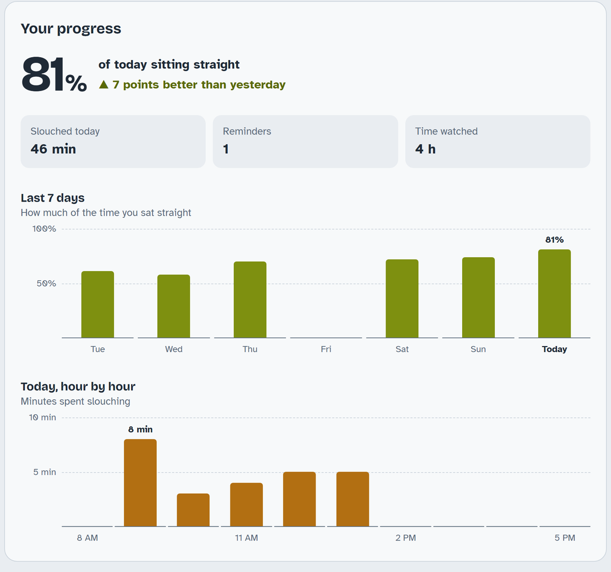
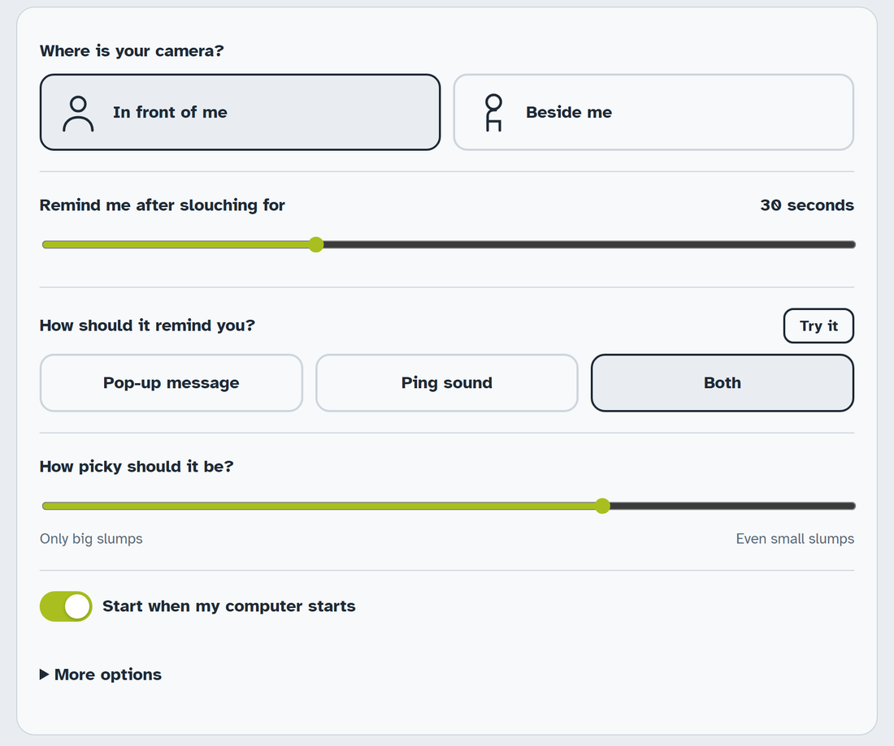

# Slouch Detector



A small Windows app that watches your posture through your webcam and reminds you to sit up straight when you've been slouching for a while.

It runs quietly in the background with a little spirit-level icon next to the clock. You don't need a browser window open.

- Works with the webcam **in front of you** (like a laptop camera) or **beside you**.
- Reminds you with a **pop-up message**, a **ping sound**, or both.
- Waits as long as you choose (10 seconds to 5 minutes) before reminding you, so shifting in your chair doesn't set it off.
- Lets go of the camera between checks, so Teams, Zoom and other apps can still use it.
- Everything happens on your computer. No video or images ever leave it.

The settings page works like a spirit level. The bubble stays between the marks while you sit straight and drifts out as you slouch:

<table>
  <tr>
    <td></td>
    <td></td>
  </tr>
</table>

## Install

You need:

- Windows 10 or 11
- A webcam
- [Python](https://www.python.org/downloads/) (tested with 3.12). In the Python installer, tick **"Add python.exe to PATH"**.

Then:

1. On this page, click the green **Code** button, then **Download ZIP**.
2. Unzip it somewhere it can stay, for example `Documents` or `Program Files`. The shortcuts point to this folder, so don't run it from Downloads and then delete the folder.
3. Double-click **`install.bat`**. It installs what's needed (this takes a few minutes the first time), adds **Slouch Detector** to your Start menu and desktop, and starts it.

The settings page opens in your browser.

## First-time setup

1. Pick where your camera is: **In front of me** or **Beside me**.
2. Sit up tall with relaxed shoulders, looking at your screen as you normally would.
3. Press **Save my good posture** and hold still for a moment.



That's it. You can close the page. Slouch Detector keeps running from the icon near the clock (click the **^** arrow if you don't see it).

## Everyday use

The tray icon shows how you're doing:

| Icon | Meaning |
|---|---|
|  | Sitting straight |
|  | Slouching |
|  | Paused, starting up, or it can't see you |

- **Click the icon** to open the settings page.
- **Right-click the icon** to **Pause** or **Quit**.
- The **On / Paused** switch at the top of the settings page also pauses it. While paused it doesn't use your camera at all.
- After **Quit**, start it again from the Start menu or the desktop shortcut.

## Your progress

The settings page also tracks how you're doing:

- **Today:** how much of the time you sat straight, compared with yesterday.
- **Slouched today, reminders and time watched.**
- **Last 7 days:** whether you're improving day by day.
- **Today, hour by hour:** when you slouch the most. For many people it's after lunch.

Hover over (or tab to) any bar to see its numbers. It only counts the time it can actually see you, so breaks, video calls and pauses don't affect your score.



## Settings



| Setting | What it does |
|---|---|
| Where is your camera? | Front or side. Changing it means saving your good posture again. |
| Remind me after slouching for | How long you have to be slouching before you get a reminder. |
| How should it remind you? | Pop-up message, ping sound, or both. **Try it** plays your choice. |
| How picky should it be? | Slide right to catch small slumps, left to catch only big ones. |
| Start when my computer starts | Turn this off if you'd rather start it yourself. |
| More options → Which camera | For computers with more than one camera. |
| More options → Check my posture every | How often it checks while the settings page is closed. |

**Tip:** if it reminds you when you're sitting fine, save your good posture again, or move "How picky" to the left.

## Troubleshooting

**"Can't see you":** your head and both shoulders (or your ear and shoulder, from the side) need to be in the camera picture. Check the preview on the settings page. The white dots show what it's tracking.

**"Camera is busy":** another app, such as a video call, is using the camera. Checking starts again when the camera is free.

**The settings page won't open:** go to <http://127.0.0.1:8765> while Slouch Detector is running.

**install.bat says Python isn't installed:** install Python from python.org with **"Add python.exe to PATH"** ticked, then run `install.bat` again.

## Uninstall

1. On the settings page, turn off **Start when my computer starts**.
2. Right-click the tray icon and choose **Quit**.
3. Delete the **Slouch Detector** shortcuts from your desktop and Start menu, then delete the folder you unzipped.
4. To also remove your saved settings, press **Win + R**, type `%LOCALAPPDATA%\SlouchDetector`, press Enter, and delete that folder.

## Privacy

- Video is analysed on your computer and is never saved or uploaded. The progress stats only store totals (minutes straight or slouching, and reminder counts), never pictures.
- The settings page is only reachable from your own computer.
- The only internet use is a one-time download of Google's MediaPipe pose model (~9 MB) on first run, plus the fonts on the settings page.

## How it works (for the curious)

`posture.py` uses [MediaPipe Pose](https://ai.google.dev/edge/mediapipe/solutions/vision/pose_landmarker) to find your nose, ears and shoulders in each camera frame, then turns them into a posture score:

- **Front view:** how high your nose is above your shoulder line, measured in shoulder widths. Slumping or craning your head forward lowers it.
- **Side view:** how far your ear leans forward of your shoulder, in degrees.

When you save your good posture, it stores the median score from a short burst of frames. After that, if the smoothed score stays past your pickiness threshold for the chosen time, you get a reminder.

While the settings page is open, it keeps the camera on for a live preview. Otherwise it opens the camera for a moment every few seconds and lets it go again.

Files:

| File | What it is |
|---|---|
| `posture.py` | The app: camera, posture scoring, tray icon, and a small local web server for the settings page |
| `settings.html` | The settings page |
| `install.bat` | One-click installer |

Everything the app writes (`settings.json` with your settings and saved posture, `history.json` with your daily progress, the downloaded pose model, the ping sound and the shortcut icon) goes to `%LOCALAPPDATA%\SlouchDetector`, never to the code folder. That way it also works when the code folder is read-only, like in Program Files.

For developers:

```bash
python posture.py              # run with readings printed to the console
python posture.py --selftest   # quick checks of the scoring and settings logic
```
